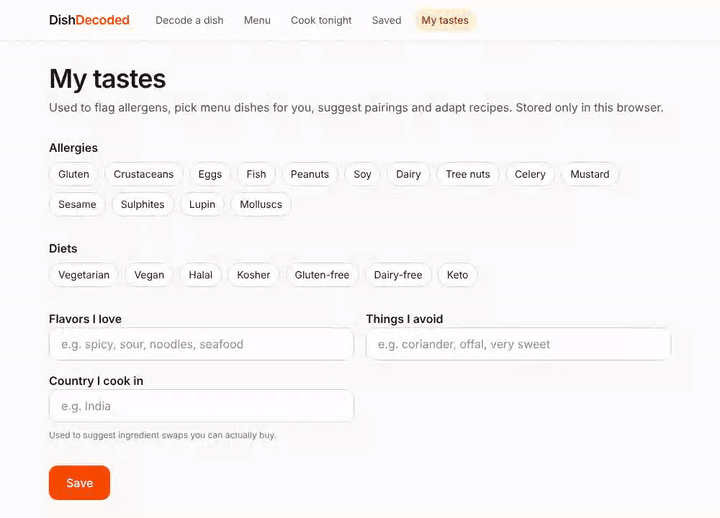
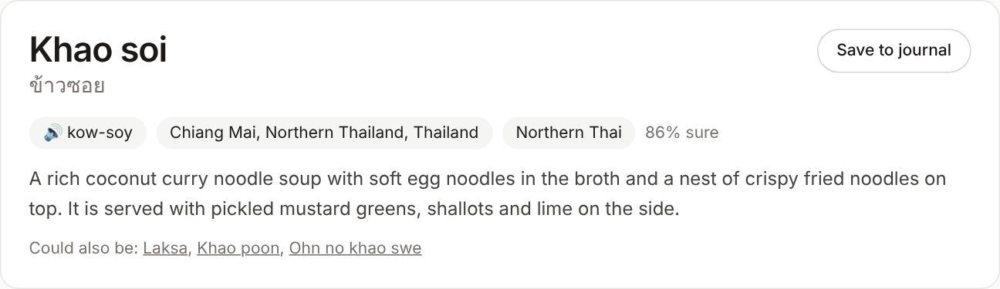
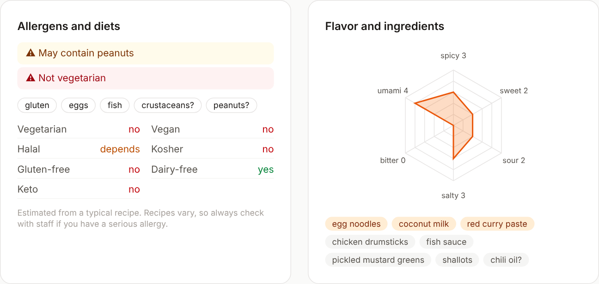
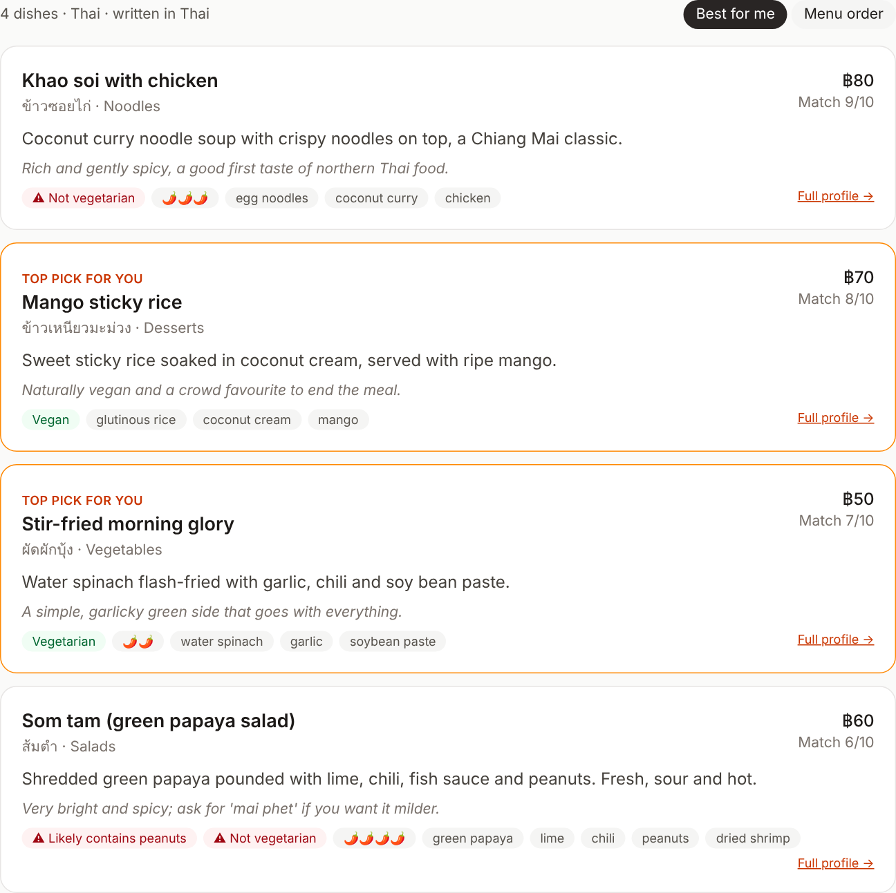
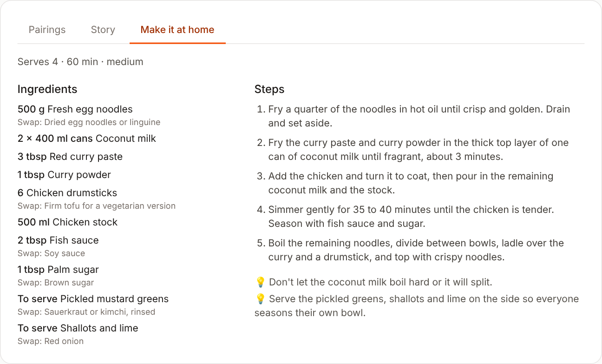
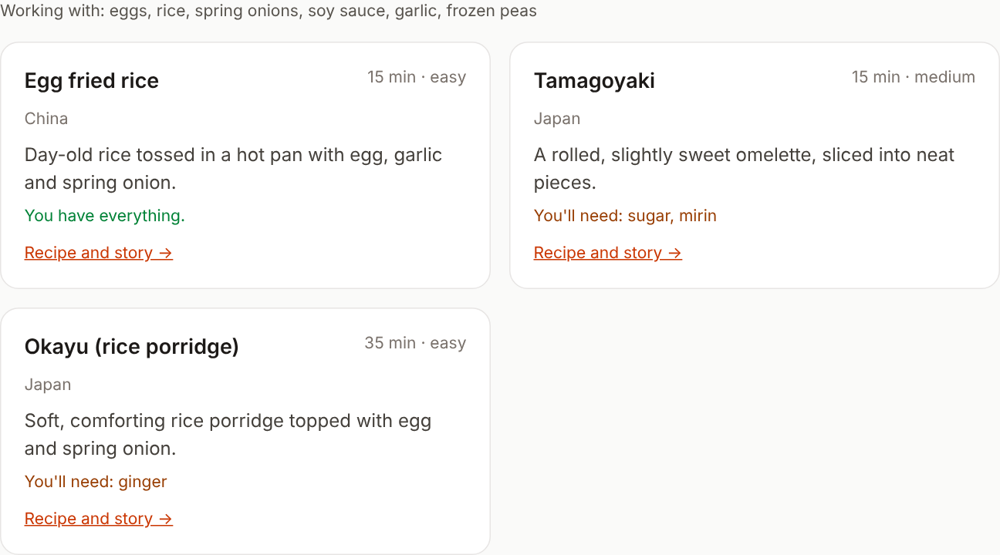
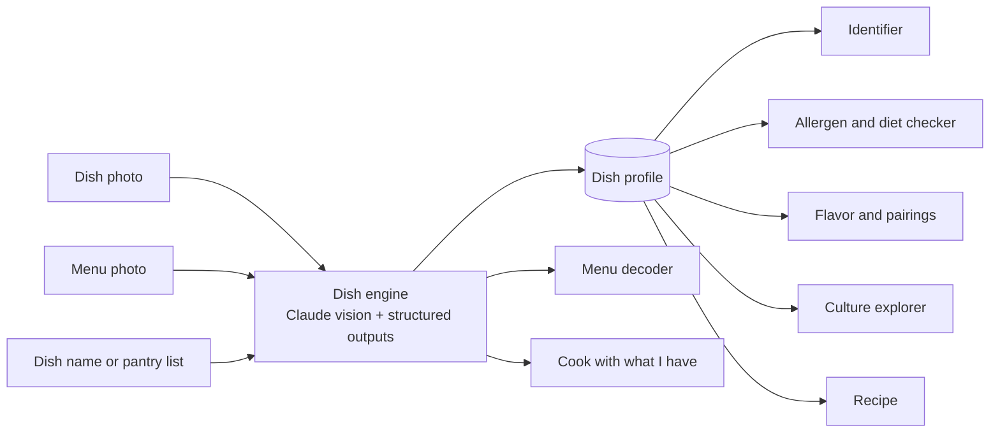

<div align="center">



**Point your camera at a dish or a menu. Find out what it is, what's in it, where it comes from, and how to make it at home.**


</div>

<div align="center">



<sub>Recorded in demo mode: decoding a dish, its allergens, story and recipe, then a Thai menu and a pantry list.</sub>

</div>

## Why

Travelling, or just at a restaurant with an unfamiliar menu, you often can't tell what a dish is, whether it's safe for your allergies, or how to say its name. Food apps mostly count calories. DishDecoded explains the food instead.

## Features

DishDecoded has seven features, and they all run on **one shared engine**. A vision model turns a photo, a menu or a dish name into a structured *dish profile*. Each feature is a thin layer on top of that profile.

| | Feature | What you get |
| --- | --- | --- |
| 📷 | **Dish identifier** | Name, native script, pronunciation with audio, origin, a plain description, and a confidence score with "could also be" alternatives |
| ⚠️ | **Allergen and diet checker** | Likely allergens and the fit for vegan, vegetarian, halal, kosher, keto and gluten-free diets, checked against *your* saved allergies |
| 🌶️ | **Flavor and pairings** | A six-axis flavor radar, drinks and sides that go with it, and similar dishes from other cuisines |
| 📜 | **Food culture explorer** | The dish's history, regional variations, how locals eat it and a fun fact |
| 🍳 | **Recipe reverse-engineering** | A home recipe with swaps for ingredients that are hard to find where you live |
| 🧾 | **Menu decoder** | Reads a menu in any language, explains every dish and ranks the best picks for you |
| 🥚 | **Cook it with what I have** | Type what's in your fridge or snap a photo of it, and get dishes you can make tonight |

## Screenshots

<sub>Captured in demo mode, which shows built-in sample results.</sub>

<table>
  <tr>
    <td colspan="2"></td>
  </tr>
  <tr>
    <td colspan="2"></td>
  </tr>
  <tr>
    <td width="50%"></td>
    <td width="50%"><br><br></td>
  </tr>
</table>

## How it works



- **One engine, typed outputs.** `src/lib/engine.ts` makes a single Claude API call per request using structured outputs. The response is validated against a Zod schema from `src/lib/schemas.ts`, so the UI never has to parse free text.
- **Cheap repeat lookups.** Text lookups and generated details (story, recipe, pairings) are cached in memory by dish name, so a second request for the same dish doesn't call the API again.
- **Allergen checks run locally.** The engine reports allergens and diet fit once. Your personal warnings are worked out in the browser from your saved profile, so they're instant and deterministic.
- **No accounts.** Your taste profile and food journal live in the browser's local storage.
- **Demo mode.** With no API key set, every route returns sample data. That lets the app be explored, or deployed publicly, at no cost.

## Tech stack

| Layer | Choice |
| --- | --- |
| Framework | Next.js 15 (App Router) with React 19 |
| Language | TypeScript |
| Styling | Tailwind CSS 4 |
| AI | Claude API (`@anthropic-ai/sdk`), with vision input and structured outputs |
| Validation | Zod |
| Storage | Browser local storage |

## Getting started

```bash
git clone https://github.com/aryankhanna1409/dishdecoded.git
cd dishdecoded
npm install
cp .env.example .env.local   # then add your ANTHROPIC_API_KEY
npm run dev
```

Open http://localhost:3000. Get an API key from the [Anthropic Console](https://console.anthropic.com). Leave the key empty to run in demo mode.

## Project structure

```
src/
├── app/
│   ├── page.tsx            # Decode a dish (identifier + dish view)
│   ├── menu/               # Menu decoder
│   ├── pantry/             # Cook it with what I have
│   ├── saved/ · dish/      # Food journal
│   ├── profile/            # Allergies, diets and tastes
│   └── api/                # identify · details · menu · pantry
├── components/             # DishView, FlavorRadar, ImagePicker, …
└── lib/
    ├── engine.ts           # Shared Claude engine + cache
    ├── schemas.ts          # Zod schemas for every output
    ├── client.ts           # Local storage, API helper, allergen checker
    └── demo.ts             # Sample data for demo mode
```

## Deploy

Deploy to [Vercel](https://vercel.com/new) or any Node host. Set `ANTHROPIC_API_KEY` in the environment variables, or leave it unset to publish the demo.

## Disclaimer

Ingredients and allergens are AI estimates based on typical recipes, and recipes vary. If you have an allergy, always confirm with the restaurant.

## License

[MIT](LICENSE)
